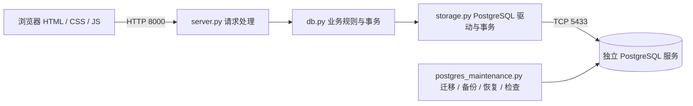

# 鲜邻 · 超市管理系统 v1.4

传统超市交易与库存管理 Demo。初始提供苹果、香蕉，支持自由上架、编辑价格、上下架、补货、购买、取消订单和库存调整。本轮对应十二周计划第一阶段的业务完善，不含 AI；暂不区分商家与客户。

**项目进度：[TASKS.md](TASKS.md)　版本变化：[CHANGELOG.md](CHANGELOG.md)　后续维护规范：[AGENTS.md](AGENTS.md)。** 每次版本更新必须同步更新任务状态、验收证据与变更记录。

## 快速运行（PostgreSQL）

当前默认使用 **PostgreSQL 17 独立服务**，Python 3.9+，驱动固定为 Psycopg 3.2.13。Windows 项目内运行：

```powershell
cd E:\shop
& .\scripts\Start-Postgres.ps1
& .\scripts\Start-Shop.ps1
```

打开 <http://127.0.0.1:8000>。网页/API 使用 8000 端口，数据库独立使用 5433 端口。按 `Ctrl+C` 仅停止网页后端；数据库继续运行。需要停止数据库时运行 `scripts\Stop-Postgres.ps1`。

服务启动后可双击项目根目录的 `打开超市.url`。不要把 `static/index.html` 当成独立网页运行；直接双击它会自动跳转到默认后端地址。若自定义网页端口，请使用该端口对应的 HTTP 地址。

本机环境已准备好；新电脑先运行 `scripts\Setup-Local.ps1` 安装项目虚拟环境、驱动和 PostgreSQL 二进制包。新空库首次启动提供苹果、香蕉；迁移原数据时先运行迁移工具，再启动网页。原有 SQLite 数据本轮已迁移，保留原库作备份。

| 配置 | 默认值 | 用途 |
| --- | --- | --- |
| `SHOP_HOST` / `SHOP_PORT` | `127.0.0.1` / `8000` | HTTP 监听地址/端口 |
| `SHOP_DB_BACKEND` | `postgresql` | 当前正式数据库；`sqlite` 为兼容旧库模式 |
| `PGHOST` / `PGPORT` | `127.0.0.1` / `5433` | 独立数据库地址/端口 |
| `PGDATABASE` / `PGUSER` | `shop` / `shop_app` | 数据库名称与业务账号 |
| `PGPASSFILE` | `.local/pgpass.conf` | 本机凭据文件，不纳入版本控制 |
| `SHOP_DB_PATH` | `data/shop.sqlite3` | 仅 SQLite 模式使用 |

**已实现数据库服务分离：** 浏览器 → HTTP 后端 → PostgreSQL TCP 连接。独立数据库进程与数据目录，不再由后端直接读写 SQLite。将 PostgreSQL 部署到另一台主机后可配置 `PGHOST`、端口、账号等连接信息，无需再次适配业务代码。

本轮同机模拟了 `8000 → 5433` 正式系统，以及 `8001 → 5434` 备份搬迁验证系统。不同端口不是物理主机隔离；跨主机云部署尚未执行。完整安装、迁移、备份和验证命令见 [PostgreSQL 运行与隔离验证](docs/PostgreSQL运行与隔离验证.md)。

## 网页功能

1. **商品管理：** 自定义名称、SKU、分类、货架分区、单价、单位、简介、初始库存及图片。SKU 可自动生成且唯一；已有 SKU 和单位暂不支持修改。
2. **展示：** 每页 6 个商品，按上架顺序分页；可搜索名称/SKU、筛选分类、切换在售和已下架商品。无图使用中性购物袋占位图。
3. **编辑：** 修改名称、价格、分类、分区、简介和图片，支持移除图片。版本冲突提示刷新，避免覆盖另一人刚保存的商品资料。
4. **上下架：** 下架保留库存、图片和历史记录，下架后禁止新购买，允许补货与重新上架。
5. **交易：** 单商品购买立即扣库存并生成订单；补货增加库存。订单按 10 条分页展示，可填写原因取消整单，取消后一次性恢复库存。
6. **库存管理：** 填写损耗、盘盈等原因，按正负整数调整库存；按商品查看分页台账，包含期初、上架入库、购买、补货、调整和取消返还。
7. **批量导入：** 上传 JSON 一次导入 1–100 个商品，要求明确 SKU；任一数据错误或 SKU 冲突时整批回滚。页面提供示例文件下载，批量图片请导入后逐个编辑。
8. **数据维护：** 页面下载商品、订单、库存台账、审计 CSV；命令行提供一致性检查、在线备份及停机恢复。

页面每 5 秒刷新数据。金额指标使用“累计净销售额”：原购买金额减已取消订单金额。取消只是本 Demo 的库存与订单冲销，尚未连接实际支付、退款或物流系统。

### 输入约束

金额用整数分存储，单价 ¥0.01–¥1,000,000.00，最多两位小数；数量只接受整数。初始库存 0–9999，单次购买/补货 1–9999，单次调整为 ±1–9999，总库存不超过 10 亿。取消与调整原因必填，最多 200 字。

名称最多 40 字，单位 8 字，简介 100 字，分区 40 字；SKU 最多 32 字，只接受字母、数字、下划线、连字符并转为大写。分类固定为水果、蔬菜、肉禽水产、乳品饮料、粮油食品、日用百货、其他。图片支持 JPG/PNG/WebP，最大 1 MB；图片字节存于数据库，分页 API 只返回图片地址。

## 项目架构



| 文件 | 职责 |
| --- | --- |
| `server.py` | 静态页面、JSON API、输入解析、CSV 导出、HTTP 错误响应 |
| `db.py` | 数据模型、迁移、商品管理、订单、库存台账、审计与查询 |
| `storage.py` / `postgres_schema.py` | 数据库驱动、配置、事务边界及 PostgreSQL 表结构 |
| `runtime.py` | SQLite 兼容模式的服务/恢复进程互斥 |
| `postgres_maintenance.py` / `maintenance.py` | PostgreSQL 迁移与归档、旧 SQLite 备份兼容入口 |
| `static/` | 页面、响应式样式、交互、缺省图片、批量导入模板 |
| `tests/test_shop.py` | 原交易、上架、上下架、分页、图片的回归测试 |
| `tests/test_business.py` | 订单、版本冲突、台账、导入、迁移、维护与 HTTP 测试 |
| `tests/test_postgres.py` | PostgreSQL 并发、幂等、事务、图片与权限验证 |
| `.github/workflows/tests.yml` | Windows/Linux 的单元测试与语法检查配置 |
| `data/` | 默认数据文件与备份，不纳入版本控制 |

详细模型与阶段成果见 [后端迭代说明](docs/后端迭代说明.md)。

### 可靠更新机制

- PostgreSQL 业务写事务使用数据库内的事务级 advisory lock，SQLite 兼容模式使用 `BEGIN IMMEDIATE`；库存、订单、明细、台账、审计与幂等结果一起提交，失败一起回滚。
- 库存通过条件更新和非负约束保护；多商品订单先检查全部商品，任一不足则整单不扣库存。PostgreSQL 提交启用同步持久化；SQLite 兼容模式保留 WAL 与完整同步。
- 写请求携带唯一 `request_id`。同一接口作用域内，同一编号与内容重试返回已保存结果；同一编号换内容返回 409。客户端需为一次操作保留编号，为新操作生成新编号。
- 商品资料用 `version` 防止并发覆盖；订单明细保存成交时名称、SKU、单位和单价快照，改价不影响旧订单。
- 取消整单与返还库存在同一事务完成；并发重复取消只返还一次。商品下架仍允许退回库存。
- `postgres_maintenance.py check` 检查库存累计与连续台账、订单金额、取消返还数量和约束状态；SQLite 模式另执行物理完整性检查。
- PostgreSQL 写事务锁跨应用进程生效，保留当前串行写入语义；数据库故障时返回 503，无 SQLite 自动回退。SQLite 模式继续持有本机服务进程锁。

旧库升级一次性补充 SKU、订单、期初与历史库存台账。旧购买保留原成交单价；旧版本没有保存的历史名称与单位只能用迁移时商品信息补齐，无法恢复不存在的历史快照。

## API

| 方法 | 路径 | 说明 |
| --- | --- | --- |
| GET | `/api/state?page=1&status=active&search=&category=` | 固定每页 6 个，状态可为 `active`/`inactive` |
| GET | `/api/categories` | 固定分类列表 |
| POST | `/api/products` | 创建商品与初始库存 |
| PATCH | `/api/products/{id}` | 编辑资料，必须提供 `version` 和 `request_id` |
| POST | `/api/product-status` | 上下架，传 `product_id`、布尔 `active`、`request_id` |
| GET | `/api/products/{id}/image` | 商品图片 |
| POST | `/api/products/import` | 事务批量导入，传 `products` 数组和 `request_id` |
| POST | `/api/movements` | 兼容单商品购买/补货接口 |
| POST | `/api/orders` | 创建多商品订单，1–50 种商品，单价由后端读取 |
| GET | `/api/orders?page=1&status=` | 每页 10 个，状态空/`completed`/`cancelled` |
| GET | `/api/orders/{id}` | 订单与成交快照 |
| POST | `/api/orders/{id}/cancel` | 整单取消，传 `reason` 和 `request_id` |
| POST | `/api/inventory/adjust` | 库存调整，传 `product_id`、`delta`、`reason`、`request_id` |
| GET | `/api/inventory?product_id=apple&page=1` | 每页 20 条台账，省略商品 ID 则查全部 |
| GET | `/api/audit?page=1` | 每页 20 条审计事件及前后值 |
| GET | `/api/export?kind=products` | CSV，可选 `products`/`orders`/`inventory`/`audit` |
| GET | `/api/health` | 服务及数据库连接检查，版本 1.4，附数据库引擎与服务端口 |

写请求使用 `Content-Type: application/json`。新建通常返回 201，重复返回 200、`duplicate: true`；PATCH 返回 200；库存不足、版本冲突、重复 SKU 或编号内容冲突返回 409。页码为正整数，超出末页自动返回末页。

创建商品示例：

```json
{
  "sku": "VEG-001",
  "name": "上海青",
  "category": "蔬菜",
  "zone": "蔬菜区 A-01",
  "unit": "袋",
  "description": "当天鲜选",
  "price_cents": 350,
  "stock": 8,
  "request_id": "listing-example-001"
}
```

多商品订单示例：

```json
{
  "request_id": "order-example-001",
  "items": [
    {"product_id": "apple", "quantity": 2},
    {"product_id": "banana", "quantity": 1}
  ]
}
```

网页当前逐个商品购买；多商品原子下单已提供后端接口，购物车界面尚未实现。`product_id` 使用查询结果中的 ID，不是 SKU。

## 备份、迁移与检查

```powershell
. .\scripts\Environment.ps1
$env:PGPORT = '5433'
& $ShopPython postgres_maintenance.py check
& $ShopPython postgres_maintenance.py backup data\backups\transfer.dump
```

备份使用 `pg_dump` 一致快照；恢复用 `pg_restore` 单事务，只允许恢复到新的空目标数据库，拒绝覆盖已有业务库。SQLite 到 PostgreSQL 的迁移工具逐字段校验全部业务表与图片，完整保留订单、台账、审计与去重数据。旧 SQLite 维护使用 `maintenance.py --database data\shop.sqlite3 ...`。

详细命令及跨端口恢复步骤见 [数据库隔离与迁移](docs/数据库隔离与迁移.md)。CSV 是报表，不是完整数据库备份。

## 验证与边界

```powershell
. .\scripts\Environment.ps1
$env:SHOP_TEST_POSTGRES = '1'
& $ShopPython -m unittest discover -s tests -v
& $ShopPython -m py_compile db.py server.py storage.py postgres_schema.py postgres_maintenance.py
node --check static/app.js
```

本机已通过 28 项 SQLite 回归测试与 15 项 PostgreSQL 测试，覆盖并发购买/取消、幂等、整单回滚、100 商品导入、快照、维护与校验。PostgreSQL 测试强制使用专用 `shop_test`，每个用例会清空测试库；正式 `shop` 不受影响。未设置测试开关时 PostgreSQL 用例跳过。已提供 Windows/Linux 回归 CI 与 PostgreSQL 17 CI 配置，远端 CI 尚未运行。

网页上架、改价、图片上传/移除、购买、取消、调整、台账、筛选、导入和 CSV 下载已在独立 PostgreSQL 测试库验证，桌面与移动端布局检查通过。Node/Playwright 仅为验证依赖。

隔离验证完成：备份从 5433 搬到 5434，全部业务表一致；修改验证库不影响正式库；停库后 HTTP 静态页面继续运行、数据/写入返回 503；重启后持久化数据不变。结果见 [验证报告](docs/postgresql-validation.json)。现有 3 个商品、45 件库存、3 个订单、7 条原记录保留。

当前没有用户登录、商家/客户权限区分、真实支付、配送或多门店隔离。数据库 TCP 分离已验证，尚未部署到云主机或做生产吞吐压测；公网部署前按计划完成身份与权限、HTTPS 和部署运维。当前按业务事务串行写入，连接池与细粒度并发控制可继续迭代。
