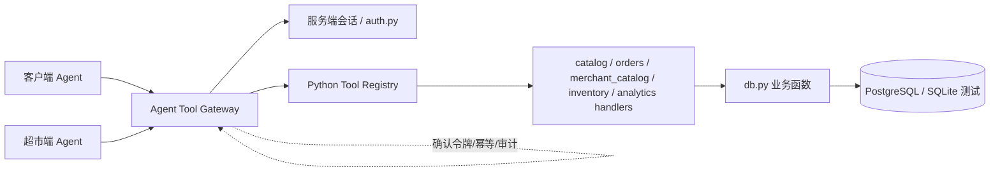

# Agent 工具封装设计（Python Registry + HTTP Adapter）

> 原名：Agent 工具接口设计。文件名保持不变，避免既有链接失效。

更新日期：2026-10-19
状态：**P1/P2 已实现**：Python Registry、HTTP Adapter、19 个工具（顾客 11、商户 8）、单商品详情、价格/库存筛选排序、顾客立即购买/取消、数据库确认令牌、原子 claim/release 和确定性编排演示已落地；P3+ 能力仍为设计，不代表已实现。

> 2026-10-26 更新：P2 商品详情、筛选排序、buy_now/取消、确认令牌持久化与编排壳已完成。商户写工具、购物车、地图、价格历史、商户取消和 AI 工具仍未实现。

本文与 [权限与角色设计](权限与角色设计.md) 配套：权限矩阵决定“谁能做什么”，本文决定“Agent 通过什么工具、以什么数据范围做”。

## 1. 文档定位、范围与状态

### 1.1 设计目标

把现有超市服务框架的商品、订单、库存、台账和审计能力，封装为客户端 Agent 和超市端 Agent 可调用的工具，并明确：

- 工具的分类、名称、功能、输入和输出；
- 每个工具对应的现有 `db.py` 函数或需要新增的接口；
- Python 工具注册表（Python Registry）如何注册、查找、校验和调用工具；
- HTTP Adapter 如何把工具暴露给独立 Agent 进程；
- 写操作的人工确认、幂等、审计和失败处理；
- 第一批可实现范围，以及明确不能宣称已实现的 AI 能力。

### 1.2 本轮状态

| 项目 | 状态 |
| --- | --- |
| 本设计文档 | 已完成并同步 P1/P2 实现 |
| Python Registry | P1/P2 已实现（`agent_registry.py`） |
| HTTP Adapter | P1/P2 已实现（`server.py` 的 `/api/agent/*`） |
| `/api/agent/tools` | P1/P2 已实现（读者 19 个工具） |
| 确认令牌/审批端点 | P1/P2 已实现（数据库 TTL、原子 claim/release） |
| 编排壳/演示 | P2 已实现（`agent_runtime.py`、`agent_demo.py`，非 AI） |
| AI 工具 | 未实现，且按 `AGENTS.md` 未获授权前不引入 |

本文中的“可用”表示**现有业务函数或 HTTP API 已具备，工具层可以直接包装**；具体是否已注册以 P1 工具目录和 `agent_tools.py` 为准。

### 1.3 状态图例

| 代码 | 含义 | 是否可进入 P1 注册表 |
| --- | --- | --- |
| `A` | 现有 `db.py` 函数/API 已具备，只需适配 | 可以 |
| `B` | 业务函数存在，但缺预览、确认、筛选、版本或端点适配 | 补齐后可以 |
| `C` | 业务表、字段、端点或数据结构缺失 | 不可以 |
| `D` | 规划中的 AI、外部数据或未授权能力 | 不可以 |
| `M` | 合并到其他工具，不单独注册 | 不单独注册 |

交付批次与实现状态分开：`P1a`、`P1b`、`P2`、`P3`、`P4` 是计划批次，不是“已实现”。

## 2. 背景、目标与非目标

### 2.1 背景

当前业务 API 已经按顾客/商户角色做了服务端拦截：

- 顾客只能读在售商品、自己的订单，并购买/取消自己的订单；
- 商户可以管理商品、库存、订单、台账、审计和导出；
- 角色来自 `auth.py` 的内存会话，`buyer_key` 只存在于顾客会话中；
- 写操作已有 `request_id` 幂等，编辑已有 `version` 版本保护。

但当前 API 仍不适合作为 Agent 工具直接暴露：

1. 模型不应该持有或传递 Cookie、角色、`buyer_key`；
2. 高风险写操作没有“预览—确认—提交”协议；
3. 缺少单商品详情、价格/库存筛选、购物车等结构化查询能力；
4. 没有工具注册表，无法按角色列出可用工具，也无法统一校验参数、错误和审计；
5. 现有接口返回的部分字段对顾客/模型过宽，需要工具层做数据裁剪。

### 2.2 目标

- 统一工具分类和命名，形成稳定契约；
- Python Registry 作为进程内核心，HTTP Adapter 作为薄传输层；
- 角色、数据范围和 `buyer_key` 只从服务端会话注入；
- 读工具无副作用，写工具支持幂等和人工确认；
- 第一批只交付可解释、可测试的非 AI 工具；
- 为后续视觉、定价、语音和顾客对话工具预留清晰边界。

### 2.3 非目标（本轮与 P1）

- 不实现真实账号、密码、统一登录或持久化会话；
- 不实现购物车、分类/货架、价格历史、地图、对象存储；
- 不调用或注册任何大模型、视觉、语音或定价模型；
- 不实现多门店/租户隔离；
- 不把 CSV、二进制图片、数据库连接或运维接口暴露给模型；
- 不修改现有权限模型和业务行为。

## 3. 设计原则

1. **最小权限**：只注册当前角色允许的工具；顾客 Agent 不能获得商户工具。
2. **角色来自会话**：`ToolContext` 由 Adapter 从服务端会话构造；模型参数禁止 `role`、`buyer_key`、`session`、`token`、`confirmed`。
3. **读写分离**：读工具无副作用；写工具必须声明 `side_effect`，高风险写操作必须 `requires_confirmation`。
4. **服务端权威**：价格、库存、版本和订单归属由服务端读取/校验；模型不能传成交价或版本自证。
5. **幂等透传**：写工具把 `request_id` 原样传给现有业务函数，不另造一套幂等语义。
6. **确认不是工具**：审批发生在 UI/管理端，不由模型调用，也不接受布尔“已确认”参数。
7. **数据最小化**：工具结果只返回角色可见字段；不返回 `buyer_key`、会话令牌、销售额给顾客。
8. **不可信文本**：商品名称、简介、OCR 文本等只作为数据返回，不能当作 Agent 指令。
9. **可审计**：工具调用记录工具名、角色、请求编号、参数摘要、确认编号、结果和耗时。
10. **AI 后置**：`AGENTS.md` 规定未经授权不引入 AI；AI 工具只登记在规划目录，不注册、不调用。

## 4. 总体架构



### 4.1 分层职责

| 层 | 职责 |
| --- | --- |
| Agent | 只产生工具名、结构化参数和自然语言解释；不接触 Cookie、角色和数据库 |
| Tool Gateway | 从会话构造角色上下文、执行工具白名单、串起确认与审计 |
| Python Registry | 注册 `ToolSpec`、按角色列出工具、解析工具、校验参数、调用 handler |
| Handlers | 把工具参数转换为现有 `db.py` 函数调用；做数据裁剪和错误映射 |
| `db.py` | 真正的业务规则、事务、幂等、版本和库存约束 |
| HTTP Adapter | 把 Registry 暴露为受会话保护的 HTTP 端点；不反向通过 Cookie 调 `/api/*` |

### 4.2 为什么 Registry 直接调用 `db.py`

- 避免 HTTP 回环、重复序列化和 Cookie 传递；
- 复用现有事务、幂等和版本逻辑；
- 由 Registry 统一做角色和数据范围，而不是让模型直接拿页面会话；
- 现有 `server.py` 继续服务网页，Adapter 只新增工具入口。

## 5. 工具分类与命名

### 5.1 命名规则

- 格式：`customer.<verb>_<object>` 或 `merchant.<verb>_<object>`；
- 工具名一旦发布保持稳定；合并/废弃时保留目录记录；
- 工具名只使用小写字母、数字、下划线；不使用中文或空格；
- 工具名在 URL 中作为路径段，例如 `POST /api/agent/tools/customer.prepare_order`。

### 5.2 领域 × 读写矩阵

| 领域 | 读工具 | 写工具 | 角色 |
| --- | --- | --- | --- |
| `catalog` | 8 | 0 | 顾客/商户 |
| `orders` | 5 | 11 | 顾客/商户 |
| `merchant_catalog` | 0 | 10 | 商户 |
| `inventory` | 1 | 4 | 商户 |
| `analytics` | 6 | 0 | 商户/顾客（顾客价格历史未实现） |
| `ai_system` | 5 | 7 | 规划，未实现 |

合计 **57 个唯一工具名**：8 + 16 + 10 + 5 + 6 + 12；其中 `customer.buy_now` 拆为 prepare/commit 两个工具名。部分名称标记为合并/排除（见 5.3），注册表只注册独立、已实现的工具。

### 5.3 合并与排除

| 工具 | 处理 |
| --- | --- |
| `customer.get_stock` | 合并进 `customer.search_products` / `customer.get_product` 的 `stock` 字段，不单独注册 |
| `customer.get_product_image` | 商品读取返回 `image_url`；二进制图片继续由现有图片端点提供，不作为 JSON 工具 |
| `merchant.export_records` | 仅后台管理/运维导出，不作为模型工具；避免绕过分页和造成数据外泄 |
| `customer.list_categories` / `merchant.list_categories` | 可共用一个 handler，但保留两个 spec，因为角色和描述不同 |
| `prepare_*` / `commit_*` | 每组是两个工具：prepare 只生成预览/令牌，commit 才产生副作用 |

## 6. 公共工具协议

### 6.1 请求 envelope（HTTP Adapter）

```json
{
  "arguments": {
    "query": "菠菜",
    "category": "蔬菜",
    "page": 1
  },
  "request_id": null,
  "confirmation_id": null
}
```

- 工具名在 URL 路径中，不在 body 中；
- `arguments` 必须是对象；无参数工具传 `{}`；
- `request_id` 只用于写操作；读工具忽略；
- `confirmation_id` 只用于 `commit_*`；
- 禁止顶层 `role`、`buyer_key`、`session`、`token`、`confirmed` 和未知字段；
- 会话 Cookie 只由 Adapter 读取，不进入模型上下文。

### 6.2 响应 envelope

```json
{
  "ok": true,
  "data": {},
  "error": null,
  "tool": "customer.search_products",
  "request_id": null,
  "duplicate": false,
  "requires_confirmation": false,
  "confirmation": null
}
```

失败：

```json
{
  "ok": false,
  "data": null,
  "error": {
    "code": "CONFIRMATION_STALE",
    "message": "商品价格或库存已变化，请重新确认",
    "status": 409,
    "details": []
  },
  "tool": "customer.commit_order",
  "request_id": "order-001",
  "duplicate": false,
  "requires_confirmation": true,
  "confirmation": null
}
```

### 6.3 错误码

| 条件 | HTTP | 错误码 |
| --- | --- | --- |
| 无/过期会话 | 401 | `UNAUTHENTICATED` |
| 已知工具但角色不符 | 403 | `FORBIDDEN` |
| 工具不存在 | 404 | `TOOL_NOT_FOUND` |
| 商品/订单不存在；顾客访问他人订单 | 404 | `NOT_FOUND` |
| JSON/envelope/参数格式错误 | 400 | `INVALID_ARGUMENT` |
| 请求体过大 | 413 | `PAYLOAD_TOO_LARGE` |
| Content-Type 不是 JSON | 415 | `UNSUPPORTED_MEDIA_TYPE` |
| 库存不足 | 409 | `STOCK_SHORTAGE` |
| 商品版本冲突 | 409 | `VERSION_CONFLICT` |
| SKU 冲突 | 409 | `SKU_CONFLICT` |
| 同一 `request_id` 不同内容 | 409 | `IDEMPOTENCY_CONFLICT` |
| 确认缺失/未批准/过期/已用/不匹配/业务已变化 | 409 | `CONFIRMATION_REQUIRED` / `CONFIRMATION_NOT_APPROVED` / `CONFIRMATION_EXPIRED` / `CONFIRMATION_USED` / `CONFIRMATION_MISMATCH` / `CONFIRMATION_STALE` |
| 数据库不可用 | 503 | `DATABASE_UNAVAILABLE` |
| 未预期异常 | 500 | `INTERNAL` |

不要通过解析中文错误字符串来判断错误码；使用异常类型、明确的 `InventoryError.status` 或 handler 主动抛出的工具错误。

### 6.4 分页、金额与时间

- 商品：现有 `snapshot` 固定每页 6 个；P1 不允许模型修改页容量。
- 订单：每页 10 个。
- 台账/审计：每页 20 个。
- 金额统一是整数分（`price_cents`、`total_cents`、`unit_price_cents`）；工具 schema 不接受浮点金额。
- 时间统一使用 ISO 8601 UTC 字符串；前端负责本地时区显示。
- 工具结果不返回 `buyer_key`、`fingerprint`、会话令牌、数据库连接信息。

### 6.5 幂等与确认

- 读工具：不需要 `request_id`、`confirmation_id`；
- 普通写工具：必须 `request_id`；
- 高风险写工具：`requires_confirmation=true`，必须 `confirmation_id`，并且 `request_id` 原样传给底层 `db.py`；
- `prepare_*`：无业务副作用，只读取/校验并生成预览和确认令牌；
- `commit_*`：必须重新校验角色、参数指纹、库存、价格/版本，确认后才写库；
- 不提供自动重试或服务端生成 `request_id`，否则重试会失去幂等。

## 7. Python Tool Registry 设计

### 7.1 职责

Registry 是进程内工具目录和执行入口：

- 注册 `ToolSpec`；
- 按 `ToolContext` 过滤可用工具；
- 解析工具并校验角色/参数；
- 处理确认令牌、幂等透传和错误映射；
- 调用 handler，返回统一 envelope。

### 7.2 ToolContext

```python
@dataclass(frozen=True)
class ToolContext:
    role: Literal["merchant", "customer"]
    buyer_key: str | None
```

- 由 Adapter 从 `auth.get_session()` 构造；
- 顾客必须有 `buyer_key`，商户为 `None`；
- 任何工具参数都不能覆盖或补充这两个字段。

### 7.3 ToolSpec

```python
@dataclass(frozen=True)
class ToolSpec:
    name: str
    domain: Literal["catalog", "orders", "merchant_catalog",
                     "inventory", "analytics", "ai_system"]
    description: str
    input_schema: dict
    allowed_roles: frozenset[str]
    side_effect: bool
    requires_confirmation: bool
    produces_confirmation: bool
    handler: Callable[[ToolCall], dict]
```

约束：

- `name` 唯一、稳定；
- `allowed_roles` 是 `{"customer","merchant"}` 的非空子集；
- `requires_confirmation => side_effect`；
- `produces_confirmation => not side_effect`；
- `side_effect => request_id 必填`；
- 只有已实现的工具能注册；`C`/`D` 只存在于本文目录。

### 7.4 ToolCall 与 Registry API

```python
@dataclass(frozen=True)
class ToolCall:
    context: ToolContext
    arguments: dict
    request_id: str | None

class ToolRegistry:
    def register(self, spec: ToolSpec) -> None: ...
    def list_for(self, ctx: ToolContext) -> list[ToolDescriptor]: ...
    def resolve(self, name: str, ctx: ToolContext) -> ToolSpec: ...
    def invoke(self, name: str, arguments: dict, ctx: ToolContext,
               request_id: str | None = None,
               confirmation_id: str | None = None) -> dict: ...
```

- `list_for` 只返回当前角色可见、已注册工具；
- `resolve` 对未知工具返回 `TOOL_NOT_FOUND`，对角色不符返回 `FORBIDDEN`；
- `confirmation_id` 的原始令牌由 Registry/确认服务校验，不直接交给 handler；
- Registry 校验通过后把受控的 `confirmation` 记录放入 `ToolCall`，handler 只能使用其中的预览，提交成功后由 Registry 消费令牌；
- handler 只返回业务 `data`，由 Registry 包装 envelope。

### 7.5 调用流水线

1. Adapter 验证会话并构造 `ToolContext`；匿名 → 401。
2. 从 URL 解析工具名；body 只接受 `arguments/request_id/confirmation_id`。
3. `resolve`：未知 → 404；角色不符 → 403。
4. 校验 `arguments` 是否符合 `input_schema`。
5. 写工具缺少 `request_id` → 400。
6. `requires_confirmation`：检查令牌状态、角色/`buyer_key` 绑定、TTL、参数指纹，并在同一写事务中把 `approved` 原子 claim 为 `consumed`。
7. handler 调用 `db.py`；角色、`buyer_key` 只来自 `ToolContext`。
8. 成功返回 envelope；handler 失败时 `release` 把令牌退回 `approved`，不产生未捕获的半状态。若进程在 claim 后崩溃，令牌保持 consumed 但没有业务结果，重新 prepare 即可（安全失败）。

### 7.6 参数校验

使用受限 JSON Schema 子集，不引入新依赖：

`type`、`properties`、`required`、`additionalProperties: false`、`enum`、`minimum`、`maximum`、`minLength`、`maxLength`、`items`、`minItems`、`maxItems`、`pattern`。

规则：

- 所有 schema 必须是对象，禁止未知字段；
- `bool` 不得当作整数接受；
- `*_cents` 只接受整数，不做字符串/浮点转换；
- 参数校验只是快速失败，`db.py` 仍是库存、版本、SKU、业务规则的最终权威；
- 同一 schema 同时用于运行时校验和 `GET /api/agent/tools` 的文档输出，避免漂移。

### 7.7 错误映射

- `InventoryError.status` 保留 400/404/409；
- 无会话 401，角色不符 403；
- 未知工具 404；
- 数据库异常 503；
- handler 主动抛出的 `ToolError(code, message, status)` 用于 `CONFIRMATION_*`、`IDEMPOTENCY_CONFLICT` 等；
- 不返回 SQL、堆栈、Cookie、`buyer_key` 或内部异常文本。

### 7.8 幂等透传

- `request_id` 是 envelope 的顶层字段，不放进 `arguments`；
- 原样传给 `db.py` 的 `request_id` 参数；
- 同一工具/同内容重试返回原结果（`duplicate: true`），同编号换内容 409；
- 不声称跨工具全局唯一；客户端应按操作生成新编号；
- 读工具忽略 `request_id`。

### 7.9 确认令牌与状态机

```text
prepare -> pending -> (UI 审批) -> approved --claim--> consumed
                    \-> expired          \--handler 失败--> released(approved)
approved -> stale (业务状态变化，需要重新 prepare)
```

令牌记录存放在 `agent_confirmations` 表（SQLite/PostgreSQL），包含：

- 不透明 ID：`cfm_` + 随机 URL-safe 字符串；
- `tool`、`state`、`arguments_fingerprint`、`preview_json`；
- `role`、`buyer_key`；
- `created_at`、`expires_at`、`approved_at`、`consumed_at`、`consumed_request_id`。

规则：

- `prepare_*` 只生成 pending 令牌，不预留库存、不修改业务数据；
- 审批只能由同一会话的 UI 端点完成，不是 Agent 工具；
- 模型不能传 `confirmed: true`；
- `commit_*` 必须使用 approved、未过期、未使用的令牌；
- 提交时重新校验商品在售、库存、价格/版本；变化则返回 `CONFIRMATION_STALE`；
- 指纹校验先于 consumed 重放判断，避免同一 request_id 换参数；
- 同一 `request_id` 重试可返回已有结果；令牌已消费后换 `request_id` 返回 `CONFIRMATION_USED`；
- 原子 claim 保证两个不同 `request_id` 不能同时提交同一确认；
- 过期记录按 24 小时清理；`reset()` 仅测试可用，并拒绝非 `shop_test` 的 PostgreSQL。

### 7.10 注册约束

- 工具名唯一；注册在启动时完成，HTTP 请求不能动态注册/替换工具；
- `allowed_roles` 必须明确；
- 所有 handler 必须接收 `ToolCall`，不得从全局/Cookie 读角色；
- 顾客 handler 必须显式传 `buyer_key`；商户 handler 必须显式使用全量范围；
- 只有 `A`/已补齐的 `B` 工具可注册；`C`/`D` 不注册；
- 注册时检查保留参数名 `role`、`buyer_key`、`session`、`token`、`confirmed`。

## 8. HTTP Adapter 设计

> 以下端点为 **P1/P2 已实现**契约；后续工具仍沿用同一 envelope。

### 8.1 端点

| 方法 | 路径 | 鉴权 | 用途 |
| --- | --- | --- | --- |
| `GET` | `/api/agent/tools` | 顾客/商户会话 | 列出当前角色可执行的工具 |
| `POST` | `/api/agent/tools/{name}` | 顾客/商户会话 | 调用一个工具 |
| `GET` | `/api/agent/confirmations/{id}` | 同一会话 | UI 获取预览/状态 |
| `POST` | `/api/agent/confirmations/{id}/approve` | 同一会话 | UI 明确批准 |

后两个端点不是 Agent 工具，不出现在工具列表中，也不允许模型调用。

### 8.2 会话与角色

- 复用现有 `auth.get_session()` 与 Cookie 会话；
- 匿名调用返回 401；
- 工具名来自 URL，角色来自会话，不能来自 body；
- `GET /api/agent/tools` 只返回当前角色可见且已注册的工具；
- Adapter 不返回 handler、内部路径、`allowed_roles`、规划中的 AI 工具或 `buyer_key`。

### 8.3 列表响应

```json
{
  "ok": true,
  "data": {
    "tools": [
      {
        "name": "customer.search_products",
        "domain": "catalog",
        "description": "搜索在售商品",
        "side_effect": false,
        "requires_confirmation": false,
        "input_schema": {}
      }
    ]
  },
  "error": null
}
```

### 8.4 状态码映射

- 401：无/过期会话；
- 403：工具存在但角色不符；
- 404：未知工具，或顾客访问他人订单；
- 400/413/415：参数、大小、Content-Type；
- 409：库存、版本、SKU、幂等、确认冲突；
- 503：数据库不可用，不静默回退 SQLite；
- 成功统一 200，包括幂等重复；不要使用 201 表达“新建订单”。

### 8.5 Cookie 与信任边界

- 请求 Cookie 只由 Adapter 读取；响应不回传 Cookie，不返回 `Set-Cookie`；
- 模型永远看不到 Cookie、会话令牌、`buyer_key`；
- 工具结果不返回 SQL、堆栈、内部文件路径；
- 商品名称/简介/图片 OCR 等是数据，不是指令；
- 生产环境还需要 CSRF Token、HTTPS、限流和审计操作人。

### 8.6 P1/P2 实现文件

- `agent_registry.py`：`ToolContext`、`ToolSpec`、`ToolCall`、`ToolRegistry`、schema 校验、原子 claim/release 和错误映射；
- `agent_tools.py`：19 个工具 handler 和注册表实例；
- `agent_confirmations.py`：数据库确认令牌、状态机、参数指纹和所有权校验；
- `server.py`：`/api/agent/tools*`、确认查询/审批路由、`GET /api/products/{id}` 和 `/api/state` 筛选参数；
- `agent_runtime.py`：HTTP 工具发现、动作执行、审批与 request_id 的编排壳；
- `agent_demo.py`：确定性购物/取消演示和 CLI；
- `tests/test_agent_tools.py`、`tests/test_agent_orchestration.py`：工具、持久化、并发 claim、端到端演示和重放测试。

后续 P3+ 工具继续在 `agent_tools.py` 注册；商户写工具、购物车、真实审批 UI 和 AI 工具仍未实现。

### 8.7 编排壳与确定性演示（非 AI）

`agent_runtime.py` 不依赖模型，只通过 HTTP 调用 Adapter：

```text
Planner.next(history) -> Action(tool, arguments, request_id?, confirmation_id?, approve?)
Runtime -> GET /api/agent/tools -> 校验工具可见性
        -> 写工具自动生成 <run_id>-<step> request_id
        -> approve=True 时读取确认、调用审批策略、再执行 commit
        -> 记录 Step，失败默认停止
```

- `Planner` 是协议；`agent_demo.BuyCancelPlanner` 是固定状态机，不代表自主智能；
- `Approver` 由调用方提供；演示默认自动批准，`--interactive` 改为人工确认；
- `agent_demo.py` 复用同一 `AgentClient`/会话和 run-id 时可验证幂等重放；
- 不调用 LLM、不联网 AI、不自动批准生产写操作。

```bash
python agent_demo.py --base http://127.0.0.1:8000 --query 苹果 \
  --run-id demo-001 --session-file .tmp/agent-demo-session.json
```

## 9. 工具目录（按领域）

> “状态/批次”中，`A`/`B` 是现有能力适配状态；`P1a`/`P1b`/`P2`/`P3`/`P4` 是计划批次。`C`/`D` 不注册。
>
> 已按本目录实现 19 个工具（顾客 11、商户 8）；其余 `C`/`D` 仍未注册。
>
> 所有写工具的 `request_id` 都原样传给 `db.py`；`confirmation_id` 只用于需要确认的 `commit_*`。

### 9.1 catalog（8 个读工具）

| 工具 | 功能与输入 | 简要实现 | 角色/数据范围 | 幂等/确认 | 状态/批次 |
| --- | --- | --- | --- | --- | --- |
| `customer.list_categories` | 分类列表；无参数 | `db.CATEGORIES`，现有 `GET /api/categories`；共享 handler，独立 spec | 顾客；只读分类 | 无 | A/P1a |
| `customer.search_products` | 搜索/分类/价格/库存/排序/页码 | `db.snapshot(..., min_price_cents, max_price_cents, in_stock, sort)`；裁剪为顾客字段 | 顾客；仅在售 | 无 | A/P2（含 P1a 基础） |
| `customer.get_product` | 单商品详情；`product_id` | `db.get_product(..., active_only=True)` + `GET /api/products/{id}` | 顾客；仅在售 | 无 | A/P2 |
| `customer.get_product_image` | 商品图片 | 现有 `db.product_image` / 图片端点；工具返回 `image_url`，不返回二进制 | 顾客 | 无 | M（合入商品读取） |
| `customer.get_stock` | 库存/可售状态 | 已是 `snapshot` 商品字段 | 顾客 | 无 | M（合入商品读取） |
| `merchant.list_products` | 商品列表；`status`、查询、价格/库存/排序、页码 | `db.snapshot`；商户可看全部状态 | 商户；全部商品 | 无 | A/P2（含 P1a 基础） |
| `merchant.get_product` | 单商品详情；`product_id` | `db.get_product` + `GET /api/products/{id}` | 商户；全部商品 | 无 | A/P2 |
| `merchant.list_categories` | 分类列表；无参数 | `db.CATEGORIES` / `GET /api/categories` | 商户 | 无 | A/P1a |

**边界**：`min_price_cents`、`max_price_cents`、`in_stock`、`sort` 已实现；`page_size` 仍固定 6 个/页，不开放可调参数。筛选后的 `product_count/pages` 按筛选统计，全店汇总字段保持原口径。

### 9.2 orders（16 个工具）

| 工具 | 功能与输入 | 简要实现 | 角色/数据范围 | 幂等/确认 | 状态/批次 |
| --- | --- | --- | --- | --- | --- |
| `customer.get_my_orders` | 自己的订单列表；`page`、`status` | `db.list_orders(page,status,buyer_key=ctx.buyer_key)` | 顾客；当前会话订单 | 无 | A/P1a |
| `customer.get_my_order` | 自己的订单详情；`order_id` | `db.get_order(id,buyer_key=ctx.buyer_key)`；他人订单 404 | 顾客；当前会话订单 | 无 | A/P1a |
| `merchant.list_orders` | 全部订单列表；`page`、`status` | `db.list_orders(..., buyer_key=None)` | 商户；全部 | 无 | A/P1a |
| `merchant.get_order` | 全部订单详情；`order_id` | `db.get_order(id, buyer_key=None)` | 商户；全部 | 无 | A/P1a |
| `customer.prepare_order` | 下单预览；`items` | 读取商品、校验在售/库存、计算服务端总额；生成确认令牌 | 顾客；自己的会话 | 无副作用；返回 `confirmation_id` | B/P1b |
| `customer.commit_order` | 提交顾客订单；`items` | `db.create_order(payload,buyer_key=ctx.buyer_key)`；复验预览价格/库存 | 顾客；自己的会话 | `request_id` + 确认令牌 | B/P1b |
| `customer.prepare_buy_now` | 立即购买预览；`product_id`、`quantity` | `db._order_items` + `_preview_order`；令牌绑定 `customer.commit_buy_now` | 顾客；自己的会话 | 无副作用；返回 `confirmation_id` | A/P2 |
| `customer.commit_buy_now` | 提交立即购买 | `db.create_order(..., expected_prices=...)` | 顾客；自己的会话 | `request_id` + 确认 | A/P2 |
| `customer.prepare_order_cancel` | 取消预览；`order_id`、`reason` | `db.get_order` 校验归属；生成确认令牌 | 顾客；自己的订单 | 无副作用 | A/P2 |
| `customer.commit_order_cancel` | 取消自己的订单 | `db.cancel_order(..., buyer_key=ctx.buyer_key)` | 顾客；自己的订单 | `request_id` + 确认 | A/P2 |
| `customer.get_cart` | 读取购物车 | 无服务端购物车；P1-11 | 顾客 | 无 | C/P3 |
| `customer.add_to_cart` | 加入购物车；`product_id`、`quantity` | 无购物车/表/API | 顾客 | 无 | C/P3 |
| `customer.update_cart` | 修改数量 | 无购物车/表/API | 顾客 | 无 | C/P3 |
| `customer.remove_from_cart` | 移除商品 | 无购物车/表/API | 顾客 | 无 | C/P3 |
| `merchant.prepare_order_cancel` | 商户取消预览；`order_id`、`reason` | `db.get_order`；生成确认令牌 | 商户；全部订单 | 无副作用 | B/P3 |
| `merchant.commit_order_cancel` | 商户取消任意订单 | `db.cancel_order(..., buyer_key=None)` | 商户；全部订单 | `request_id` + 确认 | B/P3 |

**确认要求**：`prepare_*` 不预留库存；`commit_*` 必须重新校验商品在售、库存、价格/总额，变化时返回 `CONFIRMATION_STALE`。P1b/P2 已实现预期价格复验、数据库令牌和原子 claim；已取消订单再次取消返回 `changed=false`，不会重复返还库存。

### 9.3 merchant_catalog（10 个写工具）

| 工具 | 功能与输入 | 简要实现 | 角色 | 幂等/确认 | 状态/批次 |
| --- | --- | --- | --- | --- | --- |
| `merchant.prepare_product_create` | 商品创建预览；商品字段 | 复用 `create_product` 的校验；返回规范化预览和确认令牌 | 商户 | 无副作用 | B/P3 |
| `merchant.commit_product_create` | 创建商品 | `db.create_product(payload)`；`request_id` 原样传入 | 商户 | `request_id` + 确认 | B/P3 |
| `merchant.prepare_product_edit` | 编辑预览；`product_id`、变更字段 | 读取当前 `version` 并生成前后对比/确认令牌 | 商户 | 无副作用 | B/P3 |
| `merchant.commit_product_edit` | 编辑商品 | `db.edit_product(id,payload)`；必须带 `version` | 商户 | `request_id` + `version` + 确认 | B/P3 |
| `merchant.commit_product_status` | 上下架 | `db.set_product_status(...)` | 商户 | `request_id` + 确认 | B/P3 |
| `merchant.commit_product_import` | 1–100 商品批量导入 | `db.import_products(payload)`；整批事务 | 商户 | `request_id` + 确认；建议仅后台使用 | B/P3 |
| `merchant.prepare_price_change` | 改价预览 | 读取当前价格/版本；生成差异和确认令牌 | 商户 | 无副作用 | B/P3 |
| `merchant.commit_price_change` | 改价 | `db.edit_product` 的 `price_cents` + `version` | 商户 | `request_id` + `version` + 确认 | B/P3 |
| `merchant.manage_category` | 分类增删改 | 无分类表/端点；`CATEGORIES` 固定 | 商户 | `request_id` + 确认 | C/P4 |
| `merchant.manage_shelf` | 货架/分区增删改 | 无货架表；`zone` 只是文本 | 商户 | `request_id` + 确认 | C/P4 |

图片上传/移除通过 `edit_product` 的 `image_data` 完成，不单独注册工具；批量导入不建议作为默认模型工具。

### 9.4 inventory（5 个工具）

| 工具 | 功能与输入 | 简要实现 | 角色 | 幂等/确认 | 状态/批次 |
| --- | --- | --- | --- | --- | --- |
| `merchant.get_inventory_history` | 台账；`product_id`、`page` | `db.inventory_history`，每页 20 | 商户 | 无 | A/P1a |
| `merchant.prepare_restock` | 补货预览；`product_id`、`quantity` | 读取当前库存，生成预览/确认令牌 | 商户 | 无副作用 | B/P3 |
| `merchant.commit_restock` | 补货 | `db.move_stock("restock",...)` | 商户 | `request_id` + 确认 | B/P3 |
| `merchant.prepare_inventory_adjustment` | 调整预览；`product_id`、`delta`、`reason` | 读取库存，校验范围，生成预览/令牌 | 商户 | 无副作用 | B/P3 |
| `merchant.commit_inventory_adjustment` | 调整库存 | `db.adjust_inventory(payload)` | 商户 | `request_id` + 确认 | B/P3 |

### 9.5 analytics（6 个工具）

| 工具 | 功能与输入 | 简要实现 | 角色 | 幂等/确认 | 状态/批次 |
| --- | --- | --- | --- | --- | --- |
| `merchant.get_sales_summary` | 销售额/商品/库存概览 | `db.snapshot` 的 `sales_cents`、`gross_sales_cents`、`refunded_cents`、商品/库存字段；无独立端点 | 商户 | 无 | A/P1a（用 snapshot） |
| `merchant.get_audit_events` | 审计分页 | `db.audit_history`，每页 20 | 商户 | 无 | A/P1a |
| `merchant.export_records` | CSV 导出 | `db.export_records`；后台/运维使用 | 商户 | 无 | A；不注册为 Agent 工具 |
| `merchant.get_price_history` | 商品价格历史 | 无价格历史表/行情源；P2-04 | 商户 | 无 | C/P4 |
| `merchant.get_market_quotes` | 授权行情 | 无外部数据源/采集清洗；P2-04 | 商户 | 无 | C/P4 |
| `customer.get_price_history` | 顾客可见价格历史 | 未实现；需隐私边界，不能暴露商户内部数据 | 顾客 | 无 | C/P4 |

### 9.6 ai_system（12 个规划工具）

| 工具 | 功能 | 简要实现 | 角色 | 状态 |
| --- | --- | --- | --- | --- |
| `customer.search_by_image` | 图片找货 | 无视觉/向量检索/媒体管道 | 顾客 | D（未实现） |
| `customer.get_store_map` | 门店分区/入口 | 无货架/地图表 | 顾客 | C/D |
| `customer.plan_route` | 静态路线 | 无地图/通道数据 | 顾客 | C/D |
| `customer.get_preferences` | 读取显式偏好 | 无偏好存储 | 顾客 | C/D |
| `customer.set_preferences` | 保存显式偏好 | 无存储/隐私控制 | 顾客 | C/D |
| `merchant.get_shelf_map` | 商户查看货架/地图 | 无货架/地图表 | 商户 | C/D |
| `merchant.recognize_product_image` | 图片识别候选 | 无视觉模型/适配层 | 商户 | D（未实现） |
| `merchant.suggest_product_fields` | 候选名称/类别/规格/分区 | 无视觉模型；低置信度需人工审核 | 商户 | D（未实现） |
| `merchant.suggest_price` | 建议价格区间/依据/置信度 | 无价格历史、行情或定价模型 | 商户 | D（未实现） |
| `merchant.transcribe_voice` | 语音转文字/金额候选 | 无 ASR/音频存储 | 商户 | D（未实现） |
| `merchant.apply_voice_price_correction` | 语音改价 | 需 ASR + 回显 + 确认 + 现有改价 | 商户 | D（未实现） |
| `merchant.generate_market_report` | 市场报告 | 无行情数据/报告生成 | 商户 | D（未实现） |

**AI 工具不得注册到 P1 Registry，也不得由 `GET /api/agent/tools` 返回。** 未经用户进一步授权，不引入模型、视觉、语音或外部行情数据。

## 10. 第一批交付范围

### 10.1 P1a/P2：只读工具（13 个，已实现）

顾客 5 个：

- `customer.list_categories`
- `customer.search_products`（query/category/价格/库存/排序/页码）
- `customer.get_product`
- `customer.get_my_orders`
- `customer.get_my_order`

商户 8 个：

- `merchant.list_categories`
- `merchant.list_products`（含价格/库存/排序筛选）
- `merchant.get_product`
- `merchant.list_orders`
- `merchant.get_order`
- `merchant.get_inventory_history`
- `merchant.get_audit_events`
- `merchant.get_sales_summary`

读工具需要角色过滤、顾客字段裁剪，禁止 `buyer_key`/销售额/审计泄露，并验证不改变数据库。

### 10.2 P1b/P2：顾客确认写操作（6 个，已实现）

- `customer.prepare_order` / `customer.commit_order`
- `customer.prepare_buy_now` / `customer.commit_buy_now`
- `customer.prepare_order_cancel` / `customer.commit_order_cancel`

要求：

- 确认令牌存数据库 + 审批端点；服务端生成商品、数量、单价、总额和库存快照；
- `commit_*` 重新校验在售/库存/价格/总额，变化时返回 `CONFIRMATION_STALE`；
- 不做库存预留；同一确认只能成功 claim 一次；
- 同一 `request_id` 重放走业务幂等；取消已取消订单返回 `changed=false`。

### 10.3 P1/P2 明确不做

- 商户写工具（商品创建/编辑/上下架/补货/调整，P3）；
- 购物车、分类/货架（P1-11）；
- 商户取消订单工具（P3，顾客取消已实现）；
- `merchant.export_records`（后台管理，不注册）；
- 所有 `ai_system` 工具；
- 真实认证、CSRF、限流、多门店（生产前置）；
- 可调 `page_size`（仍固定 6 个/页）。

### 10.4 验收

- 401/403/404/400/409/503 映射正确；
- 角色过滤后的工具列表正确（顾客 11、商户 8）；
- 顾客 A 不能读取/取消顾客 B 的订单；
- 结果不含 `buyer_key`，读工具不产生业务写入；
- prepare/commit 正常路径；过期/已用/不匹配/业务变化令牌均被拒绝；
- 同一 `request_id` 重复提交只产生一笔订单；
- 同一确认并发提交只成功一次；跨 store 实例仍能读取未过期令牌；
- 现有回归继续通过。

当前实现结果：48 项 SQLite + 18 项 PostgreSQL 测试全部通过；实际 HTTP 调用完成 prepare → approve → commit → 取消，库存恢复；确认令牌已持久化，原子 claim 和 release 已验证。

## 11. 未实现能力与前置条件

| 缺口 | 影响工具 | 前置条件 | 目标 |
| --- | --- | --- | --- |
| 单商品端点 | `customer.get_product`、`merchant.get_product` | 已实现 `db.get_product` + `GET /api/products/{id}` | 已完成 |
| 价格/库存筛选、排序 | `customer.search_products`、`merchant.list_products` | 已实现 `snapshot` 扩展；`page_size` 仍固定 6 | 已完成 |
| 正式审批 UI/真实操作人 | 所有 `prepare_*`/`commit_*` | 已实现数据库令牌 + 审批端点；仍需 UI 页面和真实账号绑定 | P2-03/P3 |
| 预期价格/库存复验 | `customer.commit_*` | 已实现订单创建时的预期价格和库存复验 | 已完成 |
| 无服务端购物车 | 购物车工具 | P1-11 数据/接口 | P3 |
| 固定分类、`zone` 文本 | 分类/货架工具、地图 | P1-11 分类/货架表 | P4 |
| 无价格历史/行情 | 价格/行情/定价工具 | P2-04 | P4/P5 |
| 无对象存储/音频 | 图片识别/语音工具 | 媒体存储 | P5/P6 |
| 无地图/货架结构 | 顾客路线、商户地图 | P3-03 | P4 |
| 无偏好存储 | 偏好工具 | P3-04 | P4 |
| 演示角色、内存会话、无 CSRF | 全部 | P2-03 真实认证 + 生产硬化 | 生产前 |
| 单店、无租户字段 | 全部 | P4-01 | 多店阶段 |
| AI 未授权 | `ai_system` | 明确授权 + 模型适配层 + 评测集 | 未排期 |

## 12. 安全、确认与审计

### 12.1 必须人工确认

- 顾客下单/取消订单；
- 商品创建、编辑、上下架、批量导入；
- 改价（含语音改价）；
- 补货、库存调整；
- 订单取消（商户）；
- 分类/货架变更（未来）。

### 12.2 数据边界

- 顾客：只在售商品、自己的订单；不返回销售额、流水、台账、审计、导出、`buyer_key`、他人订单。
- 商户：可读全部商品/订单/库存/台账/审计/销售汇总；不返回会话令牌、数据库凭据、`buyer_key` 或顾客敏感信息。
- 商品图片只返回 `image_url`；CSV、二进制图片、数据库连接不作为工具结果。
- 商品名称/简介/OCR 文本是不可信数据，不能作为指令执行。

### 12.3 工具调用审计

建议记录：

- 工具名、角色、`request_id`、`confirmation_id`；
- 参数指纹（不记录完整敏感参数）、结果状态、耗时；
- 审批人/审批时间（正式账号体系落地后）；
- 失败错误码。

工具调用审计与业务 `audit_events` 分开；业务审计仍由 `db.py` 写入。

### 12.4 当前安全限制

- 角色选择是演示入口，不是真实认证；会话仍在内存中；
- 确认令牌已落库并带 TTL/所有权校验，但审批人仍是演示会话，没有正式审批 UI 或真实操作人绑定；
- 没有 CSRF Token、HTTPS、限流、完整工具调用审计；
- 编排演示的自动审批只用于本机演示，不能视为生产授权；
- 生产前必须完成 P2-03 真实账号/会话与安全硬化；
- 不把“本机 HTTP 演示”描述为生产权限系统。

## 13. 测试与验收

### 13.1 P1 实现验证

自动化：

```powershell
& $ShopPython -m unittest discover -s tests -v
$env:SHOP_TEST_POSTGRES = '1'
& $ShopPython -m unittest tests.test_postgres -v
& $ShopPython scripts/check_progress.py
git diff --check
```

当前结果：SQLite 48 项 + PostgreSQL 18 项，共 66 项通过。实际 HTTP 调用已验证工具列表、商品搜索/筛选、单商品详情、prepare、confirmation 查询、approve、commit、取消订单、库存恢复、确认令牌跨实例读取和编排演示重放。

人工检查：

- 已注册工具 19 个（顾客 11、商户 8）；规划工具名 57 个，领域计数 = 8/16/10/5/6/12；
- 与 [权限与角色设计](权限与角色设计.md) 的角色/数据范围逐项一致；
- 注册表只包含 `A`/已实现 `B`，不含 `C`/`D`；
- 规划工具仍标为“未实现/需新增”，不能写成“支持/可用”；
- 检查 Markdown 链接、表格、Mermaid；
- 本次改动未提交、未推送。

### 13.2 未来实现测试矩阵

| 层级 | 用例 |
| --- | --- |
| Registry 单元 | 重名、非法角色、`requires_confirmation`/`side_effect` 约束、保留参数、bool 被当整数、未知字段 |
| HTTP 集成 | 401/403/404/400/409/413/415/503；envelope；无 `Set-Cookie`；无 `buyer_key` |
| 契约 | `GET /api/agent/tools` 按角色过滤；所有 schema 拒绝未知字段和 `role`/`buyer_key` |
| 确认 | prepare→approve→commit；pending/expired/used/mismatch/stale；重复 `request_id` 只产生一笔；并发 claim 只成功一次；跨 store 实例可读 |
| 筛选 | 价格区间、库存、排序、6 个/页；非法参数 400 |
| 隔离 | 顾客 A 不能读/取消 B 的订单；商户可读全部；顾客无销售额/台账/审计/导出 |
| 只读 | 读工具不改变数据库状态 |
| 编排 | 工具发现、审批、自动 request_id、失败停止、同会话重放不重复扣库存 |
| 回归 | 现有 48 项 SQLite + 18 项 PostgreSQL 测试保持通过 |
| AI | P1/P2 不注册、不调用任何模型/视觉/语音/外部行情 |

## 14. 实施路线图

| 阶段 | 内容 | 依赖 | 退出标准 |
| --- | --- | --- | --- |
| P1a | Python Registry + HTTP Adapter + 11 个只读工具（已完成） | 权限会话、现有 `db.py` | 角色过滤/数据裁剪/只读测试通过 |
| P1b | 顾客 `prepare_order`/`commit_order` + 确认令牌（已完成） | 确认服务、价格/库存复验 | 预览-审批-提交/过期/重复测试通过 |
| P2 | 单商品详情、价格/库存筛选、顾客 `buy_now`/取消、编排壳（已完成） | P2-05、单商品端点 | 查询/筛选/取消/持久化/重放测试通过 |
| P3 | 商户商品写工具、补货/调整、购物车、商户订单取消、正式审批 UI | P1-11、确认服务 | 所有写操作可确认、可幂等、可审计 |
| P4 | 分类/货架、价格历史/行情、地图、偏好 | P1-11、P2-04、P3-03、P3-04 | 结构化数据/规则基线可用 |
| P5+ | 图片识别、定价建议、语音修正、顾客对话/图片/路线 | 明确 AI 授权、模型适配层、评测集 | 低置信度人工纠正、硬约束评测通过 |

## 15. 附录

### 15.1 不暴露为 Agent 工具的端点

| 端点 | 原因 |
| --- | --- |
| `GET /api/health` | 运维健康检查，不是业务工具 |
| `POST /api/session`、`POST /api/logout` | 页面/会话管理，不交给模型 |
| `GET /api/products/{id}/image` | 浏览器媒体加载；工具返回 `image_url` |
| `GET /api/export` | CSV 后台导出，绕过分页，存在数据外泄风险 |
| 静态页面/JS/CSS | 仅浏览器资源 |
| 直接数据库访问 | 禁止绕过业务函数、事务和权限 |

### 15.2 关键决策与待确认问题

**P1/P2 已决定并实现：**

- 扩展现有 `docs/Agent工具接口设计.md`，不新建第二份工具目录；
- Python Registry 为核心，HTTP Adapter 为薄层；
- handler 直接调用 `db.py`，不反向调用 `/api/*` 带 Cookie；
- 角色/`buyer_key` 只从服务端会话注入；
- 写工具透传 `request_id`，高风险写操作使用 prepare/commit + 确认令牌；
- P1a 11 个只读工具 + P1b 顾客下单 + P2 详情/筛选/buy_now/取消已实现；
- HTTP Adapter 与网页共用 8000 端口和 Cookie 会话；
- 确认令牌使用数据库 TTL 和原子 claim；预期价格/库存复验已实现；
- 编排壳只做 HTTP 编排，不引入 LLM；
- `merchant.export_records` 仍不作为模型工具；
- AI 工具只作为规划条目，不注册。

**后续待确认：**

1. 正式审批 UI、真实操作人绑定和完整工具调用审计；
2. 购物车、商户写工具和商户取消订单的优先级；
3. HTTP Adapter 是否拆为独立服务；
4. AI 工具授权的具体范围、模型供应商、数据合规和评测集；
5. 真实账号/会话（P2-03 剩余）与 Agent 写操作的上线顺序。

### 15.3 当前结论

- P1/P2 已实现 Python Registry、HTTP Adapter、19 个工具、顾客下单/购买/取消确认流程和确定性编排演示；
- 确认令牌已落库，带 TTL、所有权校验和原子 claim；提交时复验商品在售、库存和价格，变化返回 `CONFIRMATION_STALE`；
- 购物车、分类/货架、价格历史、地图、商户写工具、正式审批 UI 和 AI 均未实现，不能宣称可用；
- 所有改动保留在本机，不提交、不推送。
