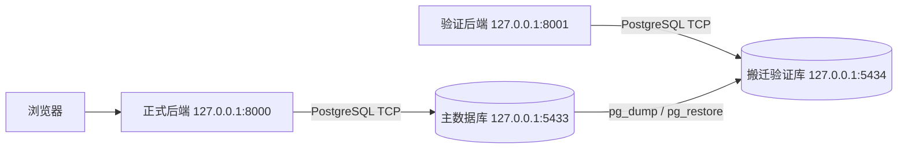

# PostgreSQL 运行与隔离验证（v1.4）

## 已交付的结构

默认后端已切换 PostgreSQL，浏览器不直接连接数据库。网页服务和数据库是不同进程，通过 TCP 通信。



| 服务 | 端口 | 数据/代码位置 |
| --- | --- | --- |
| 正式网页与 API | 8000 | 项目代码；连接 5433 的 `shop` |
| 主 PostgreSQL 集群 | 5433 | `data/postgresql/main` |
| 验证网页与 API | 8001 | 相同业务代码；连接 5434 的 `shop` |
| 验证 PostgreSQL 集群 | 5434 | `data/postgresql/replica` |
| 自动化测试数据库 | 5433 | 独立库 `shop_test`，测试会清空此库 |

`replica` 是目录名，当前为备份恢复得到的独立集群，没有配置流复制或自动同步。两套集群的端口、进程与数据目录均不同。已验证的是同一台 Windows 电脑上的服务分离、备份搬迁与故障隔离；尚未验证跨主机网络、云部署或多租户隔离。

## 环境与首次安装

- 本机已准备 PostgreSQL 17.11 Windows x64、项目 `.venv`、Psycopg 3.2.13。
- Python 3.9+；本机使用 3.9.1。固定 Psycopg 3.2.x，以兼容 Python 3.9。
- 业务依赖见 `requirements.txt`；Node 和 Playwright 只用于前端验证，不是运行依赖。
- PostgreSQL 解压在 `.tools/postgresql/pgsql`，不安装全局 Windows 服务、不修改全局 PATH。

在新 Windows 环境中：

```powershell
cd E:\shop
& .\scripts\Setup-Local.ps1
& .\scripts\Start-Postgres.ps1
```

安装脚本从 [PostgreSQL 官网](https://www.postgresql.org/download/windows/)指向的 [EDB](https://www.enterprisedb.com/download-postgresql-binaries) 下载 Windows 二进制包；驱动安装方案参考 [Psycopg 官方说明](https://www.psycopg.org/psycopg3/docs/basic/install.html)。首次启动创建密码验证的集群、非超级用户 `shop_app`、业务库 `shop` 与测试库 `shop_test`。

本机 `py` 指向 Conda Python，虚拟环境加载原 Conda 的 `Library/bin` 后才能加载 SSL DLL；`Environment.ps1` 在当前进程中自动补充该路径，未改动全局环境。

随机密码写在忽略提交的 `.local/postgres-credentials.json`；应用使用 `.local/pgpass.conf`，不向前端暴露或在启动日志中打印密码。服务账号没有超级用户、创建数据库、创建角色权限；它拥有本项目业务库与表，能执行应用迁移。本地模拟账号及配置不作为公网生产凭据复用。

## 启动正式系统

```powershell
cd E:\shop
& .\scripts\Start-Postgres.ps1
& .\scripts\Start-Shop.ps1
```

打开 <http://127.0.0.1:8000>。数据库脚本重复运行会检查已有集群与端口，不重置数据。按 `Ctrl+C` 停止网页后端；数据库是独立后台进程，会继续运行。停止数据库：

```powershell
& .\scripts\Stop-Postgres.ps1
```

若是全新空库，首次启动后端会建表并提供苹果、香蕉。**已有 SQLite 数据需要迁移时，应先执行下一节迁移命令，再启动后端**，避免先填入初始业务数据导致迁移目标不为空。

## SQLite 数据迁移

当前项目已经迁移完成，以下命令用于新空目标数据库，不能再次对已有业务数据的主库执行。

1. 停止旧 SQLite 后端，保留原文件与备份。
2. 启动 PostgreSQL，确认目标库尚无商品/订单等业务数据。
3. 执行：

```powershell
. .\scripts\Environment.ps1
& $ShopPython postgres_maintenance.py import-sqlite data\shop.sqlite3
& $ShopPython postgres_maintenance.py check
& .\scripts\Start-Shop.ps1
```

迁移工具使用 SQLite 备份 API 创建临时快照，并在副本中升级旧数据，不修改来源；同一 PostgreSQL 事务写入全部业务表，逐字段核对后提交，拒绝覆盖非空目标。图片、成交快照、库存台账、请求去重指纹和结果都迁移；同时修正 PostgreSQL 序列，防止后续插入主键冲突。

本次保留 3 个商品、45 件库存、3 个订单、7 条交易/补货记录、10 条台账、1 条上架请求。原单价、名称、库存及图片字段核对一致，净销售额 ¥29.50。保留的 SQLite 文件不再参与正式服务写入。

## 连接配置：今后搬到其他机器

| 变量 | 默认值 | 说明 |
| --- | --- | --- |
| `SHOP_DB_BACKEND` | `postgresql` | `sqlite` 仅用于保留旧库/回归测试 |
| `PGHOST` | `127.0.0.1` | 数据库主机地址，独立于 HTTP 的 `SHOP_HOST` |
| `PGPORT` | `5433` | 数据库端口，独立于 HTTP 的 `SHOP_PORT` |
| `PGDATABASE` | `shop` | 数据库名称 |
| `PGUSER` | `shop_app` | 数据库账号 |
| `PGPASSFILE` | 项目 `.local/pgpass.conf` | 由部署环境提供的密码文件 |
| `PGPASSWORD` | 未设置 | 可由运行环境注入，优先于密码文件，不写入源码 |
| `PGSSLMODE` | 使用 libpq 默认 | 跨主机部署配置适当的连接加密与证书验证 |
| `SHOP_PG_BIN` | 项目 `.tools/postgresql/pgsql/bin` | 备份恢复工具目录；也可从 PATH 查找 |

数据库部署到另一台主机后，设置对应连接信息即可使用现有后端，无需再次更换业务代码。PowerShell 中可设置 `PGHOST`、`PGPORT`、`PGDATABASE`、`PGUSER`，并用密码文件或运行环境注入凭据，再运行 `.venv\Scripts\python.exe server.py`。`Start-Shop.ps1` 是本机端口模拟脚本，会使用本机连接设置。

真实远程部署仍需配置数据库网络访问规则、账号权限、TLS、备份监控，并部署前端用户认证与操作权限。本轮没有使用云资源，未做跨主机实测。

## PostgreSQL 备份与搬迁

在线备份：

```powershell
. .\scripts\Environment.ps1
& $ShopPython postgres_maintenance.py backup data\backups\transfer.dump
```

使用 `pg_dump` 自定义归档，备份一致快照，拒绝覆盖已有备份；运行中不要复制 PostgreSQL 数据目录作为此迁移备份。将 `.dump` 传到目标机器，在**未接入应用的空业务数据库**执行恢复：

```powershell
& $ShopPython postgres_maintenance.py restore data\backups\transfer.dump
& $ShopPython postgres_maintenance.py check
```

恢复使用 `pg_restore --single-transaction --exit-on-error`，不覆盖已有目标库，不依赖原账号所有权。最终切换前停止旧入口写入、生成最终备份、恢复并核对，再切换连接；旧备份保留用于回退，避免两份独立数据各自成交。

现有 `maintenance.py backup/check/restore` 命令也会在默认 PostgreSQL 模式转发到新工具。操作旧 SQLite 文件需显式传 `--database data\shop.sqlite3`，或者设置 `SHOP_DB_BACKEND=sqlite`。

## 本机第二端口验证步骤

本轮已完成以下验证。第一次复现实验使用空的 `replica/shop`；以后重做恢复应创建新的空数据库/集群，工具拒绝覆盖既有验证记录。

```powershell
& .\scripts\Start-Postgres.ps1 -Port 5434 -Cluster replica
. .\scripts\Environment.ps1
$env:PGPORT = '5433'
& $ShopPython postgres_maintenance.py backup data\backups\new-transfer.dump
$env:PGPORT = '5434'
& $ShopPython postgres_maintenance.py restore data\backups\new-transfer.dump
& .\scripts\Start-Shop.ps1 -DatabasePort 5434 -WebPort 8001
```

单独在测试终端执行验证（需 8000 与 8001 均运行，`baseline` 要求验证库刚恢复、没有额外记录）：

```powershell
. .\scripts\Environment.ps1
$env:PGPORT = '5433'
& $ShopPython scripts\verify_postgres_isolation.py baseline
& .\scripts\Stop-Postgres.ps1 -Cluster replica
& $ShopPython scripts\verify_postgres_isolation.py offline
& .\scripts\Start-Postgres.ps1 -Port 5434 -Cluster replica
& $ShopPython scripts\verify_postgres_isolation.py recovered
```

每一步必须完成后再执行下一步。验证脚本只在 5434 的验证库新增演示商品与交易，不改主库；记录输出见 [postgresql-validation.json](postgresql-validation.json)。

### 已验证结果

- 8000 健康检查返回 `engine=postgresql, port=5433`；8001 返回 `port=5434`。
- 备份恢复后全部业务表的数量与字段摘要一致，图片字节保留。
- 在验证库上架、购买、重复购买、改价、取消，主库全部业务表摘要不变。
- 停止 5434 后，8001 的静态网页仍返回 200，健康、数据与写请求返回 503；8000/5433 持续正常。
- 重启 5434 后，停止前的全部字段摘要一致，后端无需重启即可重新读取。
- 断库时的购买未提交，也没有退回 SQLite 写入；恢复后用原编号提交只扣减一次。
- 28 项 SQLite 回归测试、15 项 PostgreSQL 测试通过；网页交互在独立 `shop_test` 库验证通过。

## 测试与并发机制

```powershell
. .\scripts\Environment.ps1
$env:SHOP_TEST_POSTGRES = '1'
& $ShopPython -m unittest discover -s tests -v
& $ShopPython -m py_compile db.py server.py storage.py postgres_schema.py postgres_maintenance.py
node --check static/app.js
```

PostgreSQL 测试强制连接专用 `shop_test`，每个用例会清空它；不会清空 `shop`。未设置测试开关时 15 项 PostgreSQL 测试跳过，其余回归使用临时 SQLite。

当前写事务取得数据库内的事务级 advisory lock，串行处理本项目的业务写操作；该锁跨后端进程有效，配合唯一约束、条件扣减、整单回滚和请求去重，保证当前 Demo 的一致性。读事务使用一致快照。金额使用 BIGINT 整数分，商品分页使用显式 `sort_order`；PG 与 SQLite 的事务、占位符、插入 ID 和迁移差异集中于持久化层。

这是保留已有可靠性语义的适配，未进行生产吞吐压测；更高并发可进一步拆为按请求/商品锁定并引入连接池。当前每次业务调用独立建立连接，3 秒连接超时、10 秒锁等待和 12 秒语句超时。检查工具验证业务余额与约束状态，不等于 PostgreSQL 数据页离线完整性扫描。

## 本机管理文件

| 文件/目录 | 用途 |
| --- | --- |
| `storage.py` | 数据库配置、驱动、事务边界、参数与结果适配 |
| `postgres_schema.py` | PostgreSQL 显式表结构与初始化 |
| `postgres_maintenance.py` | 数据迁移、pg_dump/pg_restore、一致性检查 |
| `scripts/` | 安装、集群启动停止、网页启动、隔离验证 |
| `data/postgresql/logs/main.log` / `replica.log` | 数据库日志，置于 PGDATA 外避免 Windows 文件占用影响恢复 |
| `.local/` | 仅本机凭据，忽略提交，不在报告中展示 |
| `.tools/`、`.venv/`、`data/` | 运行时与数据，忽略提交 |

CI 已增加独立 PostgreSQL 17 服务的测试任务；本机验证已完成，远端 CI 尚未实际运行。
