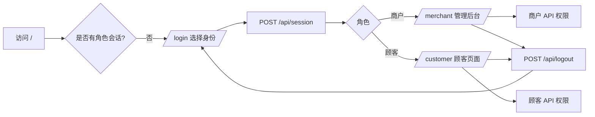

# 权限与角色设计（演示版）

更新日期：2026-10-18
适用范围：超市服务框架的身份选择、页面分流与接口权限。当前为**角色模拟**，不是生产级认证系统。

## 1. 目标与边界

### 目标

- 访问超市时手动选择身份，不需要账号和密码。
- 商户进入管理后台，顾客进入顾客选购页。
- 服务端按角色拦截页面与 API，而不是只隐藏前端按钮。
- 提供明确的退出登录入口，退出后回到身份选择页。
- 顾客只能看到当前会话自己的订单；商户可以查看全部订单。

### 明确不做

- 不创建账号、不保存密码、不做注册/找回密码/第三方登录。
- 不提供真实身份认证、审计人员身份、登录风控或多因素认证。
- 不做跨会话订单归属：顾客退出后重新选择身份，会创建新的匿名会话，旧会话订单不再可见。
- 不做购物车、支付、地图和多门店权限。

> **安全边界：** 任何人都可以在 `/login` 选择“商户”，因此本设计只能用于演示和功能验证，不能作为生产权限系统。正式版本需要账号密码或统一身份认证、持久化会话、操作人审计和 HTTPS。

## 2. 角色与页面

| 角色 | 页面 | 说明 |
| --- | --- | --- |
| 匿名访问 | `/login` | 选择“商户”或“顾客”；不校验账号密码 |
| 商户 | `/merchant` | 商品、库存、订单、台账、审计、导入与导出 |
| 顾客 | `/customer` | 浏览在售商品、购买、查看当前会话订单、取消自己的订单 |
| 已登录访问 `/` | 自动跳转 | 商户 → `/merchant`；顾客 → `/customer` |
| 错误角色访问页面 | 自动跳转 | 顾客访问 `/merchant` → `/customer`；商户访问 `/customer` → `/merchant` |



## 3. 会话与退出

- 登录：`POST /api/session`，请求体 `{"role": "merchant" | "customer"}`。
- 页面路由和 API 都从服务端会话读取角色，客户端不能通过修改页面元素获得权限。
- 会话保存在服务进程内存中，使用随机令牌；令牌写入 `shop_session` Cookie。
- Cookie 属性：`HttpOnly; SameSite=Lax; Path=/; Max-Age=43200`。本机 HTTP 演示不设置 `Secure`。
- 会话有效期 12 小时；服务重启会使所有会话失效，需要重新选择身份。
- 退出：`POST /api/logout`，删除服务端会话并清除 Cookie，前端跳回 `/login`。
- API 未登录返回 `401`；角色不匹配返回 `403`；页面访问错误角色时重定向到该角色自己的页面。

## 4. 权限矩阵

### 4.1 页面权限

| 页面 | 匿名 | 顾客 | 商户 |
| --- | --- | --- | --- |
| `/login` | 允许 | 允许 | 允许 |
| `/merchant` | 重定向 `/login` | 重定向 `/customer` | 允许 |
| `/customer` | 重定向 `/login` | 允许 | 重定向 `/merchant` |
| `/` | 重定向 `/login` | 重定向 `/customer` | 重定向 `/merchant` |
| CSS / JS / 占位图 | 允许 | 允许 | 允许 |

### 4.2 API 权限

| 方法与路径 | 匿名 | 顾客 | 商户 | 数据范围 / 说明 |
| --- | --- | --- | --- | --- |
| `GET /api/health` | 允许 | 允许 | 允许 | 服务与数据库健康检查 |
| `GET /api/session` | 允许 | 允许 | 允许 | 只返回当前角色，不返回令牌 |
| `POST /api/session` | 允许 | 允许 | 允许 | 选择/切换身份，无密码 |
| `POST /api/logout` | 允许 | 允许 | 允许 | 清除当前会话 |
| `GET /api/state` | 拒绝 | 允许 | 允许 | 顾客强制只看在售商品，且不返回销售额、最近流水、下架统计等后台数据 |
| `GET /api/categories` | 拒绝 | 允许 | 允许 | 固定分类列表 |
| `GET /api/products/{id}/image` | 拒绝 | 允许 | 允许 | 商品图片 |
| `POST /api/products` | 拒绝 | 拒绝 | 允许 | 商户上架 |
| `PATCH /api/products/{id}` | 拒绝 | 拒绝 | 允许 | 商户编辑商品/价格/图片 |
| `POST /api/product-status` | 拒绝 | 拒绝 | 允许 | 商户上下架 |
| `POST /api/products/import` | 拒绝 | 拒绝 | 允许 | 商户批量导入 |
| `POST /api/movements`（`purchase`） | 拒绝 | 允许 | 拒绝 | 顾客购买；订单写入顾客 `buyer_key` |
| `POST /api/movements`（`restock`） | 拒绝 | 拒绝 | 允许 | 商户补货 |
| `POST /api/orders` | 拒绝 | 允许 | 拒绝 | 顾客创建多商品订单；订单写入 `buyer_key` |
| `GET /api/orders` | 拒绝 | 允许 | 允许 | 顾客只返回当前会话订单；商户返回全部 |
| `GET /api/orders/{id}` | 拒绝 | 仅自己的订单 | 全部订单 | 非本人订单按不存在处理（404），避免泄露订单存在性 |
| `POST /api/orders/{id}/cancel` | 拒绝 | 仅自己的订单 | 全部订单 | 取消原因必填；库存只返还一次 |
| `POST /api/inventory/adjust` | 拒绝 | 拒绝 | 允许 | 商户调整库存 |
| `GET /api/inventory` | 拒绝 | 拒绝 | 允许 | 商户查看库存台账 |
| `GET /api/audit` | 拒绝 | 拒绝 | 允许 | 商户查看审计 |
| `GET /api/export` | 拒绝 | 拒绝 | 允许 | 商户导出 CSV |

### 4.3 资源级权限

| 资源 | 顾客 | 商户 |
| --- | --- | --- |
| 在售商品资料 | 读取 | 读取、创建、编辑、上下架、导入 |
| 已下架商品 | 不可见 | 可见、可重新上架 |
| 商品图片 | 读取 | 读取、上传、移除 |
| 库存与台账 | 仅通过商品卡片看到当前库存 | 调整、补货、查看完整台账 |
| 订单 | 当前会话创建的订单 | 全部订单 |
| 销售额/最近流水/审计 | 不可见 | 可见 |
| CSV 导出 | 不可用 | 商品/订单/库存/审计 |

## 5. 数据模型变更

### 订单归属

`orders` 表新增可空字段：

```sql
buyer_key TEXT
```

- 顾客购买或创建订单时写入当前会话的匿名 `buyer_key`。
- 顾客查询、查看详情、取消订单时强制带上 `buyer_key`。
- 商户查询不带该过滤条件，可查看全部订单。
- 历史订单的 `buyer_key` 为 `NULL`，仅商户可见。
- 新增索引：`orders(buyer_key, created_at DESC, id)`。
- `buyer_key` 不返回给前端；退出后会话丢失，旧订单无法从顾客端继续访问。

### 不需要新增的表

本版不创建 `users`、`roles`、`sessions` 或密码表；角色会话只在进程内存中。正式账号体系落地时需要新增用户、角色、会话/令牌和审计操作人字段。

## 6. 前端行为

- `/login`：两张身份卡片，点击后 `POST /api/session` 并跳转。
- 商户页：顶部显示“商户”和退出按钮；商品卡片不提供购买按钮，保留补货、编辑、调整、台账、上下架。
- 顾客页：顶部显示“顾客”和退出按钮；只显示在售商品、购买弹窗、当前会话订单和取消按钮。
- 任意 API 返回 `401` 时，前端自动跳回 `/login`。
- 退出后回到 `/login`，不再保留角色页面。

## 7. 安全与限制

| 项目 | 当前状态 | 正式版本要求 |
| --- | --- | --- |
| 身份真实性 | 自选角色，无校验 | 账号密码/统一登录，多因素认证 |
| 账号密码 | 不创建、不保存 | 加盐哈希、密码策略、找回流程 |
| 会话 | 内存随机会话，12 小时 | 持久化会话、刷新/撤销、设备管理 |
| 权限 | 服务端角色拦截 | 角色/权限表、最小权限、越权回归 |
| API 防护 | JSON + SameSite Cookie + 同源页面 | CSRF Token、限流、HTTPS、WAF |
| 审计 | 记录业务事件，无真实操作人 | 绑定用户/角色/IP/会话的可追溯审计 |
| 订单归属 | 当前匿名会话 | 账号级订单归属与跨设备历史 |
| 多门店 | 未实现 | `tenant_id`/`store_id` + 行级隔离 |

## 8. 验收与测试

自动化测试位于 `tests/test_permissions.py`，覆盖：

1. 匿名访问 `/api/state` 返回 401；匿名访问页面重定向 `/login`。
2. 商户/顾客访问错误页面时重定向到各自页面。
3. 顾客可读在售商品，但看不到销售额、最近流水和已下架商品。
4. 顾客不能上架、编辑、上下架、导入、调整库存、补货、看台账/审计/导出（403）。
5. 商户不能购买或创建订单（403）。
6. 顾客可以购买；订单只对当前会话顾客可见；其他顾客查看/取消返回 404。
7. 顾客可以取消自己的订单；商户可以取消任意订单。
8. 退出后会话失效，API 返回 401；非法角色返回 400。

验证结果：SQLite 48 项、PostgreSQL 18 项测试通过（共 66 项，其中 PostgreSQL 测试需显式启用；权限测试 4 项仍包含在 SQLite 回归中）。

## 9. 后续演进

1. 建立真实 `users`、`roles`、`sessions`/令牌表，替换内存会话。
2. 账号登录、密码哈希或统一身份认证；登录失败限流与锁定。
3. 审计事件补充 `actor_id`、`actor_role`、IP 和会话编号。
4. 顾客订单归属改为账号级；支持跨设备历史订单。
5. 增加 CSRF Token、HTTPS、权限回归和越权渗透测试。
6. 在多门店阶段加入 `tenant_id`/`store_id` 与查询边界。
